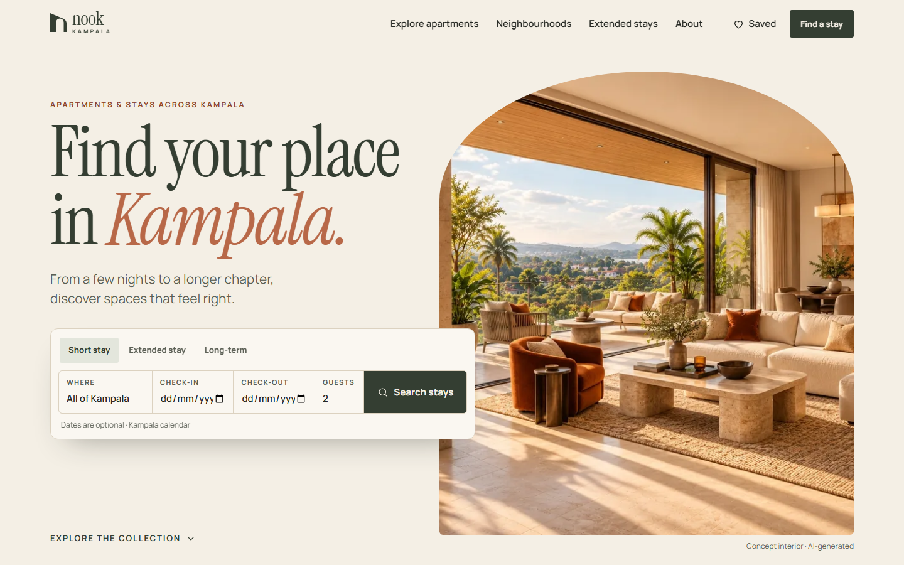

# Nook Kampala — apartment platform concept

An independent apartment discovery and booking concept for Kampala. A cinematic GSAP landing page leads
into searchable listings, rich property galleries, saved stays, comparison, and complete short-stay
booking, extended-stay, viewing and contact journeys. Everything runs in the browser and ends with an
honest demonstration confirmation.

**Live:** https://nook-kampala-concept.pages.dev

> **Independent apartment-platform concept. All properties and availability shown are illustrative.**
> The six homes are fictional, photography is AI-generated, and every rate, fee and available date is
> concept data. No reservation, payment, message or viewing request is ever sent.



## Features

- **Homepage** — live-type hero (“Find your place in Kampala.”) beside an arched photograph that opens
  through a mask; a search panel with stay-type-aware fields (dates for short stays, approximate move-in
  for longer ones); featured homes; one short pinned desktop scene moving from interiors to shared pools,
  gyms and workspaces; a neighbourhood index; extended stays; the demo booking journey; FAQ; closing CTA.
- **Apartments** — neighbourhood, stay type, dates, guests, bedrooms, price (nightly or monthly, never
  mixed) and amenity filters, all in the URL; sorting; active chips; reset; empty state; mobile filter sheet.
  With valid dates, results exclude homes blacked out on the demo calendar and show the stay total.
- **Property pages** — image grid and lightbox (arrows, keys, swipe, Escape, focus trap and restore,
  captions, count), specifications, amenities grouped as in-apartment / shared / building with
  pictured-or-not labels, ways to stay, house rules, sticky booking panel, compact mobile CTA, related homes.
- **Saved and compare** — save from cards and pages; compare up to three with a nightly/monthly rate switch.
  Only property IDs persist, in one versioned localStorage key, validated on read with corrupt-data recovery.
- **Short-stay booking** (`/book/:slug`) — stay details → guest details → review → confirmation at
  `/booking-demo/:reference`. Kampala-calendar date rules, minimum and maximum nights, guest capacity, a
  deterministic demo blackout calendar, a running price summary from the first step, sample details,
  edit links, duplicate-action guard, print summary and a refresh fallback.
- **Extended stays, viewings, contact** — enquiry, Kampala-time viewing preference and contact forms on
  the same engine, each with review and an honest demo confirmation.
- **Neighbourhoods, About, Privacy & demo notice, Not found.**

## How it is built

React 19 · TypeScript · Vite 7 · React Router 7 (lazy routes) · GSAP 3 + ScrollTrigger via `@gsap/react`
(homepage chunk only) · plain CSS design tokens · Vitest · Playwright.

- `src/data` — typed listings and neighbourhoods. Amenity allocations follow `property-guide.json`.
- `src/lib/stay.ts` — date-only night counting, date rules, the demo calendar and the single pricing rule
  (nightly × nights + one-off cleaning fee, whole UGX; no taxes, deposits or discounts are modelled).
- `src/lib/filters.ts` — URL parsing/serialising, matching and sorting.
- `src/lib/collection.ts` — the saved/compare store (`useSyncExternalStore`, versioned storage).
- `src/forms` — a declarative form engine: specs in `flows.ts` drive fields, validation, review and
  confirmation. Drafts and confirmations live only in memory.

## Develop

```bash
npm install
npm run dev                          # http://127.0.0.1:5173
npm test                             # filters, storage recovery, dates, capacity, pricing, booking steps
npm run build                        # type-check + production build to dist/
npm run preview -- --port 4175       # serve dist/
npm run verify                       # browser journeys against :4175 (local Chrome; set CHROME_PATH if needed)
npm run images                       # regenerate derivatives from assets-src/original (Python 3 + Pillow)
```

`npm run verify` runs one compact journey: hero search, amenity filters, gallery, save and refresh,
compare, invalid → corrected → edited booking through to confirmation and refresh fallback, extended
stay, viewing, contact, unknown and not-found routes, keyboard menu, reduced motion, GSAP pin count after
repeated navigation and resizing, overflow at 360–1440px, and a network audit (no non-GET requests, no
third parties beyond Google Fonts, no personal data in URLs). Against production:
`VERIFY_URL=https://nook-kampala-concept.pages.dev npm run verify`.

## Demo boundaries

- No backend, database, authentication, payments, analytics, maps or external form services.
- Personal details stay in memory; they never reach localStorage, URLs, cookies or logs.
- No ratings, reviews, host identities, real addresses, scarcity messages or popularity claims.
- Neighbourhood pages give broad positioning only — no travel times, distances or safety claims.

## Assets

See [docs/ASSETS.md](docs/ASSETS.md) for originals, derivatives, the vector logo rebuild and the amenity
notes. The artwork is not covered by an open-source licence.

## Deploy (Cloudflare Pages, Direct Upload)

```bash
npx wrangler login     # once
npm run deploy         # build + wrangler pages deploy dist --project-name nook-kampala-concept --branch main
```

`public/_redirects` serves `index.html` for every route so direct links and refreshes work;
`public/_headers` sets caching and basic security headers. Pushing to GitHub does not redeploy — run
`npm run deploy`. Open Graph URLs use `VITE_SITE_URL` from `.env.production`.
